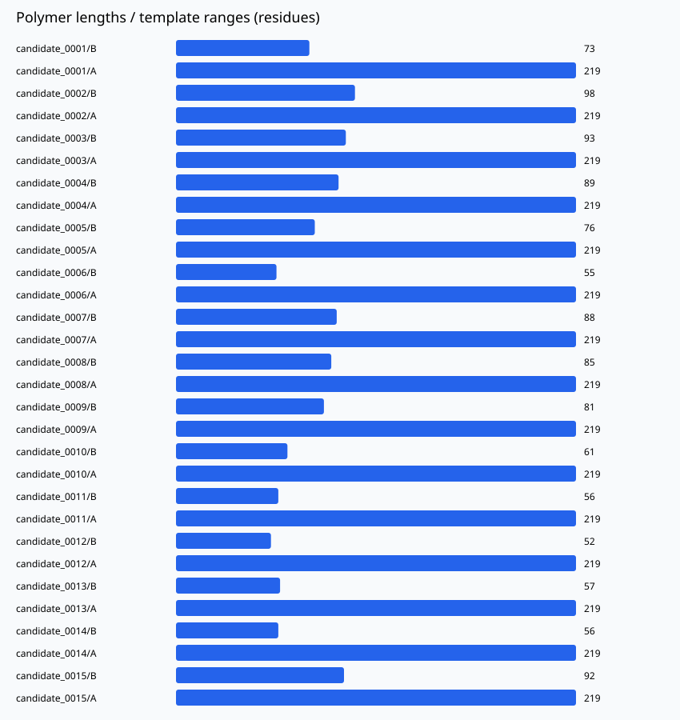

# RFD4-Proteina 运行报告

## 运行概览

| 项目 | 内容 |
| --- | --- |
| 状态 | 成功 |
| 任务类型 | generate |
| 结构数量 | 50 |
| 用时 | 3899.4 秒 |

## 方法说明

调用固定版本 RFD4-Proteina 联合生成序列与全原子结构，保留 CIF 条件及来源注释。几何指标用于计算筛选，不代表实验结合活性或独立折叠验证。
输入预检与结构评估返回的是输入结构；不会标记为新生成候选。

## 结果展示与说明

| 结构编号 | 角色 | 聚合物链 |
| --- | --- | --- |
| candidate_0001 | generated | B: protein 73, A: protein 219 |
| candidate_0002 | generated | B: protein 98, A: protein 219 |
| candidate_0003 | generated | B: protein 93, A: protein 219 |
| candidate_0004 | generated | B: protein 89, A: protein 219 |
| candidate_0005 | generated | B: protein 76, A: protein 219 |
| candidate_0006 | generated | B: protein 55, A: protein 219 |
| candidate_0007 | generated | B: protein 88, A: protein 219 |
| candidate_0008 | generated | B: protein 85, A: protein 219 |
| candidate_0009 | generated | B: protein 81, A: protein 219 |
| candidate_0010 | generated | B: protein 61, A: protein 219 |
| candidate_0011 | generated | B: protein 56, A: protein 219 |
| candidate_0012 | generated | B: protein 52, A: protein 219 |
| candidate_0013 | generated | B: protein 57, A: protein 219 |
| candidate_0014 | generated | B: protein 56, A: protein 219 |
| candidate_0015 | generated | B: protein 92, A: protein 219 |
| candidate_0016 | generated | B: protein 62, A: protein 219 |
| candidate_0017 | generated | B: protein 58, A: protein 219 |
| candidate_0018 | generated | B: protein 96, A: protein 219 |
| candidate_0019 | generated | B: protein 60, A: protein 219 |
| candidate_0020 | generated | B: protein 100, A: protein 219 |
| candidate_0021 | generated | B: protein 61, A: protein 219 |
| candidate_0022 | generated | B: protein 49, A: protein 219 |
| candidate_0023 | generated | B: protein 98, A: protein 219 |
| candidate_0024 | generated | B: protein 44, A: protein 219 |
| candidate_0025 | generated | B: protein 60, A: protein 219 |
| candidate_0026 | generated | B: protein 40, A: protein 219 |
| candidate_0027 | generated | B: protein 87, A: protein 219 |
| candidate_0028 | generated | B: protein 81, A: protein 219 |
| candidate_0029 | generated | B: protein 50, A: protein 219 |
| candidate_0030 | generated | B: protein 55, A: protein 219 |

候选按原生文件顺序排列。primary_structure 是首个结构；未声明其评分最优。
序列文件按每条聚合物链导出；未知或修饰残基在 FASTA 中用 X，原始名称保留在 summary.json。
预检输入中的可扩展片段以实际允许的长度范围展示；占位标记不计为已生成的完整序列。

### 原生评分预览

| 结果行 | 指标 | 数值 |
| --- | --- | --- |
| 1 | `bond_length_metrics.bond_length.frac_unreasonable` | 0 |
| 1 | `bond_length_metrics.bond_length.frac_unreasonable.within_residue` | 0 |
| 1 | `bond_length_metrics.bond_length.frac_unreasonable.between_residue.within_chain` | 0 |
| 1 | `clash_metrics.frac_atoms_clashing_1p5A` | 0 |
| 1 | `clash_metrics.frac_atoms_clashing_intra_residue_polymer_1p5A` | 0 |
| 1 | `clash_metrics.frac_atoms_clashing_intra_residue_ligand_1p5A` | 0 |
| 1 | `clash_metrics.frac_atoms_clashing_inter_residue_polymer_polymer_1p5A` | 0 |
| 1 | `clash_metrics.frac_atoms_clashing_inter_residue_polymer_ligand_1p5A` | 0 |
| 1 | `clash_metrics.frac_atoms_clashing_inter_residue_ligand_ligand_1p5A` | 0 |
| 1 | `hotspot_obedience.hotspot_obedience` | 0.8 |
| 1 | `interchain_interactions.hbond_atom_count_coi` | 10 |
| 1 | `interchain_interactions.hbond_atom_pair_count_coi` | 16 |
| 1 | `interchain_interactions.pistack_residue_count_coi` | 0 |
| 1 | `interchain_interactions.pistack_residue_pair_count_coi` | 0 |
| 1 | `interchain_interactions.pication_residue_count_coi` | 1 |
| 1 | `interchain_interactions.pication_residue_pair_count_coi` | 1 |
| 1 | `interchain_interactions.saltbridge_residue_count_coi` | 3 |
| 1 | `interchain_interactions.saltbridge_residue_pair_count_coi` | 3 |
| 1 | `interchain_interactions.hydrophobic_atom_count_coi` | 6 |
| 1 | `interchain_interactions.hydrophobic_atom_pair_count_coi` | 6 |
| 1 | `interchain_interactions.metal_coord_atom_count_coi` | 0 |
| 1 | `interchain_interactions.metal_coord_atom_pair_count_coi` | 0 |
| 1 | `sequence_adherence.sequence_adherence` | 1 |
| 1 | `sequence_adherence.n_violations` | 0 |
| 1 | `sequence_probability_adherence.zero_adherence` | 1 |
| 1 | `sequence_probability_adherence.one_adherence` | 1 |
| 1 | `sequence_probability_adherence.n_zero_conditions` | 5913 |
| 1 | `sequence_probability_adherence.n_zero_violations` | 0 |
| 1 | `sequence_probability_adherence.n_one_conditions` | 219 |
| 1 | `sequence_probability_adherence.n_one_violations` | 0 |

保留上游指标名称，不合并不同含义的指标作排名；完整数值和参数记录见 metrics.csv。

## 可视化结果



链长图展示最多前 30 条链，完整记录见 summary.json。

### candidate_0001

```molstar
./results/structures/candidate_0001.cif
```

### candidate_0002

```molstar
./results/structures/candidate_0002.cif
```

### candidate_0003

```molstar
./results/structures/candidate_0003.cif
```

### candidate_0004

```molstar
./results/structures/candidate_0004.cif
```

### candidate_0005

```molstar
./results/structures/candidate_0005.cif
```

### candidate_0006

```molstar
./results/structures/candidate_0006.cif
```

## 如何查看结果

- report.md：人类可读报告与结构预览。
- summary.json：状态、输入、来源、候选、序列与原生指标记录。
- manifest.json：文件角色、大小和 SHA-256；不递归记录自身与最终 ZIP。
- sequences.fasta / metrics.csv：下游序列和评分接口。
- results.zip：完整结果、原生输出、输入快照、配置和日志。

## 后续分析建议

结合序列多样性、几何质量和目标约束筛选多个候选，再进行独立结构预测、物理分析和实验验证。

## 功能边界

本镜像包含设计模型和本地几何指标。AlphaFold/OpenFold 外部折叠、PyRosetta、Foldseek 数据库及训练不包含在当前 Kit 的执行入口；原生注释 CIF 可表达的条件均原样保留。
多体条件通过注释 CIF 提供；逐项条件表单覆盖上游支持的单体条件。
